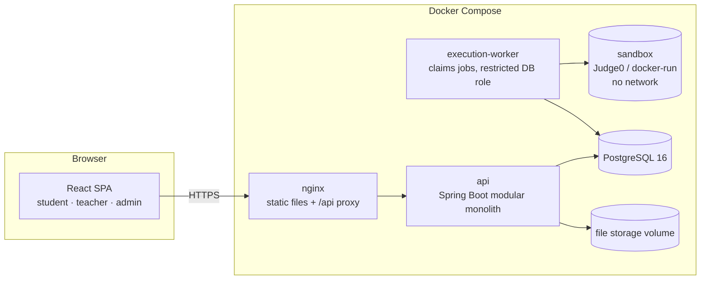
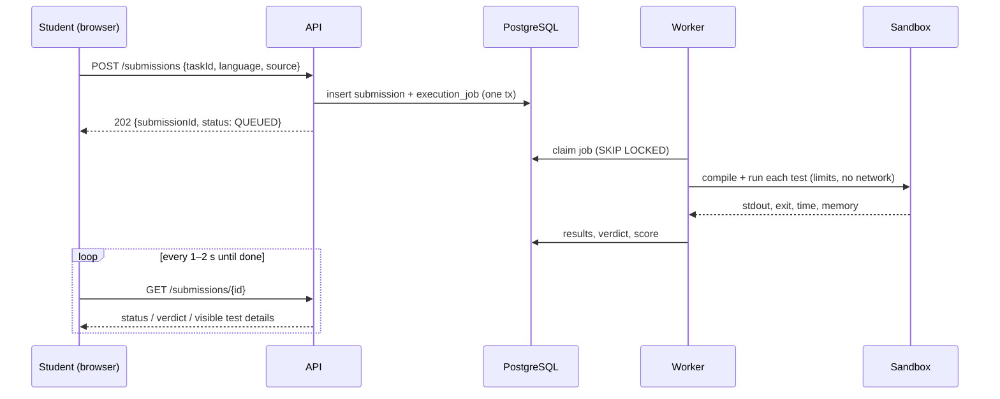
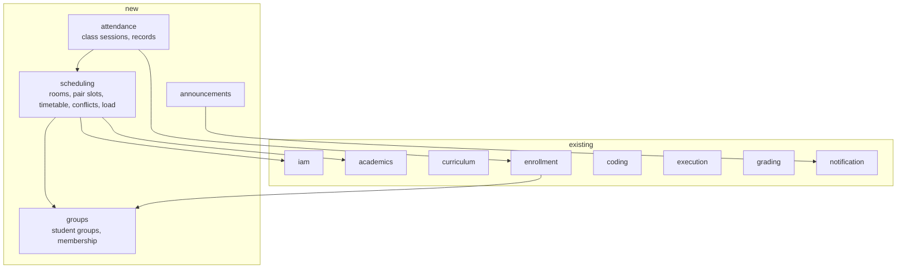
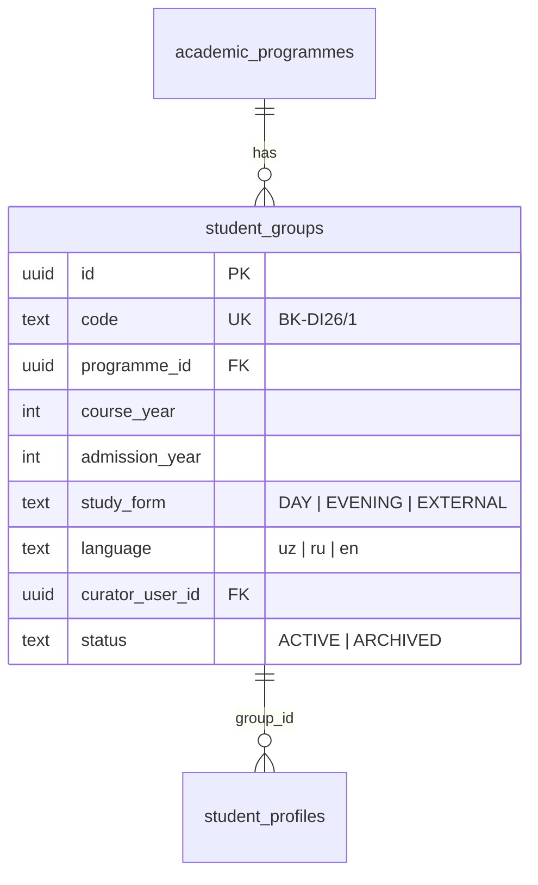
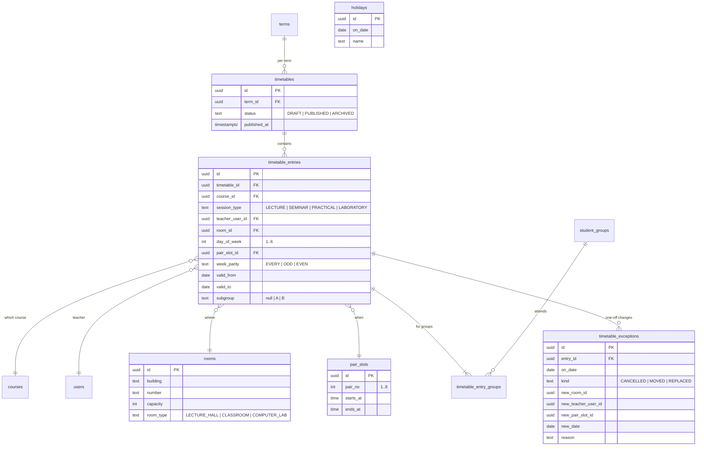
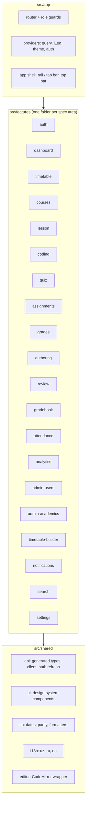
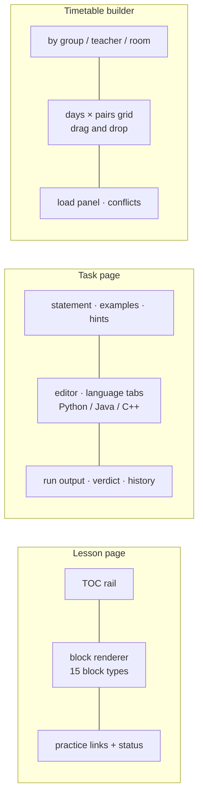
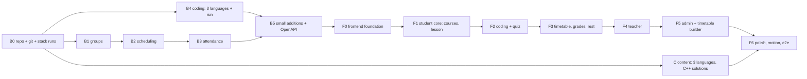

# AIFU Learning Platform — Architecture (v3)

Companion to `01-PRODUCT-SPEC.md`. It says how the product is built: what is kept, what is added,
and how the new frontend is structured.

## 1. Decisions

| # | Decision | Why |
|---|---|---|
| D1 | **Keep the backend from `New refresh Project`** as the base | 482 Java files, 250+ tests green, sound security (sandboxed execution, append-only grades, 404-not-403), 5 subjects with content. A rewrite would spend weeks re-earning this |
| D2 | **Add the missing backend modules first**, then build the frontend against the real API | The earlier frontends were told "don't touch the backend", so features without endpoints (timetable) could not exist |
| D3 | **New frontend from scratch**, spec-driven (one phase = a set of spec IDs) | The owner rejected both existing frontends; a clean, typed, feature-sliced codebase is cheaper than repairing two |
| D4 | **One repository** `aifu-platform/` with `backend/`, `frontend/`, `content/`, `docs/`, under git | Nothing was under git before; one repo keeps API and UI changes together |
| D5 | **Types generated from OpenAPI** | The frontend cannot drift from the API; a missing endpoint is a compile error, not a runtime surprise |
| D6 | **Content is data, not dev seed**: lesson packs in `content/` imported by a tool | Lessons must exist in every environment, in three languages, and be re-importable after edits |
| D7 | Code runs in **Python, Java, C++** through the existing execution worker | C++ already has a row (disabled) and a Judge0 id; Java was added in V018 |

## 2. System overview

Student code never runs in the API process: `POST /submissions` and `POST /runs` only insert a
job; the worker claims it (`FOR UPDATE SKIP LOCKED`), runs it in the sandbox with CPU, memory,
process and output limits and no network, and writes the result. The browser polls.

## 3. Backend: what exists (keep)

Spring Boot 3.3, Java 21, PostgreSQL 16, Flyway, modular monolith with ArchUnit-enforced
boundaries, plus the execution worker. Modules: `common iam academics curriculum enrollment
progress assessment coding execution grading files notification analytics audit search`.
About 180 endpoints under `/api/v1` (catalogue, curriculum authoring, lessons, quizzes, coding
tasks, submissions, grades, analytics, users, audit). Read `backend/CLAUDE.md` before changing it:
its rules (Flyway only, DTO records, permission checks in `AccessGuard`, no student code in the API
process) stay in force.

## 4. Backend: what is added

### 4.1 Groups (B1) — built
A group used to be only a text column `student_profiles.group_code`. It is now an entity; the
column references `student_groups.code`, and an unknown code creates the group.

Migration backfills groups from existing `group_code` values. New: `POST /admin/enrollments/by-group`
(enroll every active student of a group into a course).

### 4.2 Scheduling (B2) — timetable — built

**Conflict rule.** Two entries of one timetable clash when they share `day_of_week` and
`pair_slot_id`, their parities overlap (`EVERY` overlaps everything; `ODD` and `EVEN` do not overlap
each other), their date ranges overlap, and they share the teacher, the room, or a group (same
subgroup, or either has none). The service checks before every insert/update and returns
`409 TIMETABLE_CONFLICT` with the clashing entries in `details.conflicts`. Every write first
takes a row lock on the timetable, so two concurrent admins cannot both pass the check. Capacity,
room-type, inactive-room, teacher-not-assigned and other-term mismatches are warnings
(`details.warnings`): they also answer 409 until the request repeats with `force=true` and a
`forceReason` (audited).

**Week parity.** `terms` gets `first_week_parity` (ODD by default); the week number is counted
from the term's first Monday. The API returns for any date: week number, parity, and the
occurrences of that week with exceptions and holidays already applied — the frontend never
computes parity itself.

Endpoints (all under `/api/v1`) — **built and tested (V019, `SchedulingIT`)**:

| Method and path | Who | Purpose |
|---|---|---|
| `POST /admin/groups`, `PUT/DELETE /admin/groups/{id}`, `PUT /admin/groups/{id}/archived?value=` | ADMIN | Groups |
| `POST /admin/groups/{id}/students`, `DELETE /admin/groups/{id}/students/{userId}` | ADMIN | Roster |
| `GET /groups`, `GET /groups/{id}`, `GET /groups/{id}/students` | ADMIN, TEACHER | Read groups and rosters |
| `GET/POST /admin/rooms`, `PUT/DELETE /admin/rooms/{id}` (same for `/admin/pair-slots`), `GET/POST /admin/holidays`, `DELETE /admin/holidays/{id}` | ADMIN | Reference data |
| `PUT /admin/terms/{termId}/first-week-parity` | ADMIN | Whether week 1 is ODD or EVEN |
| `GET/POST /admin/timetables`, `GET/DELETE /admin/timetables/{id}`, `PUT …/name`, `POST …/publish`, `POST …/archive` | ADMIN | Lifecycle; `copyFromId` in the create body copies a timetable |
| `GET /admin/timetables/{id}/entries?groupId=&teacherId=&roomId=` | ADMIN | Builder grid by view |
| `POST /admin/timetables/{id}/entries`, `PUT/DELETE /admin/timetable-entries/{id}` | ADMIN | Add / edit or move / delete; 409 with conflicts or warnings |
| `POST /admin/timetables/{id}/entries/check?editedEntryId=` | ADMIN | Dry run for the drag preview |
| `GET/POST /admin/timetable-entries/{id}/exceptions`, `DELETE /admin/timetable-exceptions/{id}` | ADMIN | Cancel / move / replace on a date; notifies teacher and students |
| `GET /admin/timetables/{id}/week?date=&groupId=…` | ADMIN | Preview a concrete week of a draft |
| `GET /admin/timetables/{id}/load?groupId=|teacherId=` | ADMIN | Planned vs scheduled hours (a pair = 2 hours) |
| `GET/PUT /admin/teaching-load?termId=`, `DELETE /admin/teaching-load/{id}` | ADMIN | Yuklama lines; the client parses the Excel sheet and PUTs the rows |
| `GET /timetable/me?date=&as=student|teacher` | STUDENT, TEACHER | My week (by my group / by me as teacher) |
| `GET /timetable/today` | STUDENT, TEACHER | Dashboard block (campus date, Asia/Tashkent) |
| `GET /timetable/week?date=&groupId=|teacherId=|roomId=` | any signed-in user | Any published week |
| `GET /timetable/pair-slots`, `GET /timetable/rooms` | any signed-in user | Bell schedule, rooms |

Class statuses in a week: `SCHEDULED`, `CANCELLED`, `MOVED_OUT` (original slot of a moved class),
`MOVED_IN` (its new slot), `REPLACED` (other teacher or room), `HOLIDAY`.

### 4.3 Attendance and class sessions (B3)
`class_sessions` (entry + date, linked `lesson_id`, teacher notes) is created on first open of
a class occurrence; `attendance_records` (session, student, status PRESENT / ABSENT / LATE /
EXCUSED, note). Endpoints: `GET/PUT /teacher/class-sessions/{entryId}/{date}`,
`PUT …/attendance`, `GET /teacher/courses/{id}/attendance` (journal grid),
`GET /attendance/me?courseId=`.

### 4.4 Coding: three languages and "Run" (B4)
- Migration V020 enables `cpp` and the docker-run sandbox has a `gcc:13` spec — **done**. `go`
  stays an enabled row but unused.
- `POST /runs {taskId?, language, source, stdin?, mode: CUSTOM | EXAMPLES}` → 202; `GET /runs/{id}`.
  Same queue and sandbox as submissions, lower priority, rate-limited per student, results kept
  24 h, never graded, never touches hidden tests.
- `GET /coding-tasks/{id}/hints` (student; revealed one at a time, reveal is recorded).
- `GET /submissions/{id}/feedback` (student reads the teacher's feedback).
- `POST /teacher/coding-tasks/{id}/verify` — runs every reference solution against all tests.
- Content: C++ starter + solution for each of the 52 existing tasks (see `05-CONTENT-PROMPTS.md`).

### 4.5 Small additions (B5)
- `GET /courses/{id}/lessons/progress/me` — status of every lesson of a course for the student.
- Teacher-only lesson plan: a `LESSON_PLAN` content block type with `visibility = TEACHER_ONLY`.
- Announcements: `POST /teacher/courses/{id}/announcements`, `GET /announcements/me`.
- Exports: gradebook and attendance journal as `.xlsx`.
- `GET /me/dashboard` is **not** added: the dashboard composes existing endpoints in parallel.
- Student import with group: `POST /admin/users/import` (CSV/XLSX).
- OpenAPI: `docs/api/openapi.json` committed and regenerated in CI; the frontend generates types
  from it.

### 4.6 Content pipeline (B6)
`content/<SUBJECT_CODE>/…` holds lesson packs as files (Markdown with front matter + YAML for
tasks and quizzes), one folder per locale. `tools/content-import` validates them (every lesson has
all required sections, every task has three language solutions that pass its tests) and upserts
through the same services the teacher editors use. It replaces the 12 000-line dev seed SQL as the
way content enters a database.

## 5. Frontend architecture (new)

**Stack.** React 18 + TypeScript (strict) · Vite · Tailwind CSS with design tokens · shadcn/ui
(Radix primitives) · React Router 6 (lazy routes) · TanStack Query (server state) · React Hook
Form + Zod · react-i18next (uz / ru / en) · CodeMirror 6 (python, java, cpp) · dnd-kit (timetable
drag and drop) · Recharts (analytics) · Motion + GSAP (animation) · openapi-typescript +
openapi-fetch (typed API client) · Vitest + Testing Library · Playwright (e2e).

Rules:
- A feature folder owns its pages, components, hooks (`useXxxQuery`), and Zod schemas. Features
  never import each other's internals; shared code moves to `shared/`.
- Components never call `fetch`. All server access goes through typed hooks built on the
  generated client. Query keys include the locale for localized content.
- Every page handles loading, empty, error and content states (shared `<QueryBoundary>`).
- No user-visible string in a component: everything through `t()`; the three locale files have
  the same keys (checked in CI).
- Routes: `/` role home · `/timetable` · `/courses` · `/courses/:id` · `/lessons/:id` ·
  `/tasks/:id` · `/quizzes/:id` · `/assignments` · `/grades` · `/teach/...` · `/admin/...`.

### Key screens' structure

## 6. Design direction

AIFU's emblem is a shield split navy over magenta. Tokens: navy `#0A2F5F` (structure, primary),
magenta `#E8105A` (the single "next action / now" accent), neutral cool greys, status colours for
status only, six session-type colours (lecture, seminar, practical, lab, independent, course
work) used consistently in the timetable, course plan and badges. Type: a slab serif for headings
and long lesson prose, a grotesque with good Cyrillic for UI, JetBrains Mono for code (ligatures
off). The designer-model is free to raise the craft (layout, depth, illustration, motion) inside
these constraints; the logo is in `backend/academic-materials/branding/`.

## 7. Motion

Purposeful, not decorative: route transitions (fade + 8 px slide, 200 ms); staggered list reveal
on first load only; progress rings and bars animate to their value; the verdict reveal after a
submission (tests tick in one by one, then the verdict); drag feedback and conflict shake in the
timetable builder; a subtle animated hero on login and the student dashboard (GSAP). Animate only
`transform` and `opacity`; everything is disabled under `prefers-reduced-motion`.

## 8. Quality gates

- Backend: `./mvnw clean verify -Pit` green; new modules get unit + integration tests, including
  conflict detection cases and authorization (a student cannot read another group's attendance).
- Frontend: `npm run lint && npm run typecheck && npm test && npm run build` green; i18n key
  parity check; Playwright flows for the acceptance demo (SPEC §9) on desktop and mobile sizes.
- One `scripts/verify` at the repo root runs both. `docker compose up --build` starts everything.

## 9. Build order

Backend prompts: `03-BACKEND-PROMPTS.md`. Frontend prompts: `04-FRONTEND-PROMPTS.md`.
Content prompts: `05-CONTENT-PROMPTS.md`.
