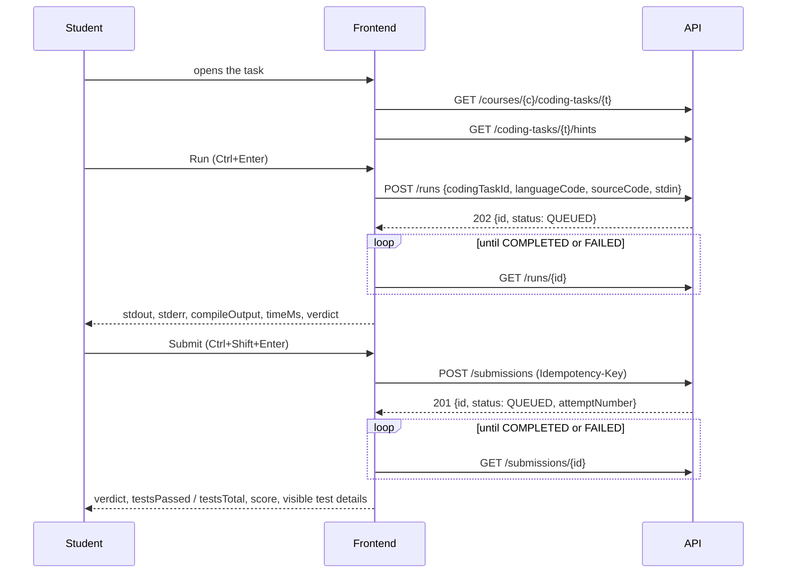

# AIFU Learning Platform — API guide for the frontend

How to use the backend from the browser, and which endpoints each screen of
`01-PRODUCT-SPEC.md` is built from. Three files work together:

| File | What it is | Use it for |
|---|---|---|
| `docs/api/openapi.json` | The contract, generated from the running backend and checked by a test | Generating TypeScript types (`openapi-typescript`) |
| `docs/api/ENDPOINTS.md` | One line per operation, generated from the contract | Finding an endpoint |
| this guide | Rules and the screen-to-endpoint map | Knowing how to call it and what to build from what |

If this guide and the contract disagree, the contract is right; report the difference.

## 1. Running the backend

```
cp .env.example .env        # set JWT_SECRET (openssl rand -base64 48)
docker compose up -d --build
```

- API: `http://localhost:8080` · Swagger UI: `/swagger-ui.html` · contract: `/v3/api-docs`
- The compose file runs the `dev` profile, which loads the demo database (section 9).
- CORS allows `http://localhost:5173` and `http://localhost:3000`. In development, proxy `/api`
  from Vite to `http://localhost:8080` so the browser sees one origin.
- Student code runs in the `execution-worker` container. If it is not running, runs and
  submissions stay `QUEUED`; a run is failed by the server after ten minutes.

## 2. Conventions

- Base path `/api/v1`. JSON in, JSON out, UTF-8.
- **A `null` field is left out of the response.** Treat a missing property as `null`. The contract
  marks nothing as required, so generated types make every property optional: narrow them at the
  edge (a `zod` schema or a small mapper per feature), not all over the components.
- **Success codes** are the ones the contract lists: `200`, `201` for a create, `202` for a
  queued run, `204` with no body for deletes and some updates. Treat any 2xx as success and do
  not parse a body after `204`.
- Ids are UUID strings. Instants are ISO-8601 in UTC (`2026-10-02T08:37:31Z`); dates are
  `YYYY-MM-DD`; a time of day is `HH:mm:ss`. Show times in the campus zone, **Asia/Tashkent**.
- **Locale.** Send `?locale=uz|ru|en` (or `Accept-Language`) on every read of translated content.
  Responses say when they fell back: `titleIsFallback`, `payloadIsFallback`. Show a small
  "shown in Uzbek" mark in that case (spec G-01).
- **Pagination.** List endpoints take `page` (from 0), `size` (default 20, capped at 100) and
  `sort=property,asc|desc`, and answer `PageResponse…` `{content, page, size, totalElements,
  totalPages, hasNext, hasPrevious}`. Endpoints that return a plain array are small by nature.
- **Errors.** Every failure is
  `{code, message, details?, requestId, timestamp, path}`. Branch on `code`, never on `message`.
  Show `message` only as a fallback; translate by `code`. Keep `requestId` in the error UI.

| HTTP | `code` | What the UI does |
|---|---|---|
| 400 | `VALIDATION_FAILED` (`details.fields` = field → message), `MALFORMED_REQUEST`, `UNSUPPORTED_LOCALE` | Mark the fields |
| 401 | `AUTH_INVALID_CREDENTIALS`, `AUTH_ACCOUNT_NOT_ACTIVE` | Login form error |
| 401 | `AUTH_TOKEN_EXPIRED` | Refresh once, retry the request |
| 401 | `AUTH_TOKEN_MISSING`, `AUTH_TOKEN_INVALID`, `AUTH_REFRESH_TOKEN_INVALID`, `AUTH_REFRESH_TOKEN_REUSED` | Clear the session, go to login |
| 403 | `AUTH_FORBIDDEN`, `NOT_COURSE_TEACHER`, `NOT_ENROLLED` | "No access" page or message |
| 404 | `RESOURCE_NOT_FOUND` | Not-found state. Also returned for things that exist but are not yours |
| 409 | `TIMETABLE_CONFLICT` (`details.conflicts`, `details.warnings`), `RESOURCE_ALREADY_EXISTS`, `CONCURRENT_MODIFICATION`, `ENROLLMENT_DUPLICATE`, `ATTEMPT_ALREADY_OPEN`, `ATTEMPT_ALREADY_SUBMITTED` | Explain; for `CONCURRENT_MODIFICATION` reload and retry |
| 422 | `ATTEMPT_LIMIT_REACHED`, `ATTEMPT_EXPIRED`, `LANGUAGE_NOT_ENABLED`, `SOURCE_TOO_LARGE`, `UNSAFE_CONTENT_REJECTED`, `INVALID_STATE_TRANSITION`, `TRANSLATION_INCOMPLETE`, `PUBLICATION_VALIDATION_FAILED`, `GRADE_IMMUTABLE`, `FILE_TYPE_NOT_ALLOWED` | Explain next to the action |
| 429 | `RATE_LIMIT_EXCEEDED`, `TOO_MANY_CONCURRENT_SUBMISSIONS` | "Wait a moment"; do not retry automatically |
| 503 | `EXECUTION_ENGINE_UNAVAILABLE`, `STORAGE_UNAVAILABLE` | Error state with retry |

## 3. Authentication

1. `POST /auth/login {identifier, password}` → `{accessToken, refreshToken, expiresInSeconds,
   mustChangePassword}`. The access token lives 15 minutes; send it as
   `Authorization: Bearer …`.
2. `GET /auth/me` → `{id, username, fullName, email, roles[], permissions[], preferredLocale,
   groupCode?, studentNumber?, mustChangePassword}`. Build navigation from `roles`; hide single
   actions by `permissions`.
3. **`mustChangePassword = true`** → send the user to the change-password screen before anything
   else (`PUT /auth/password {currentPassword, newPassword}`). The server does not block other
   calls, so the frontend must. Changing the password revokes every refresh token: log in again
   with the new password right after.
4. **Refresh.** `POST /auth/refresh {refreshToken}` returns a new pair; the old refresh token is
   **single use**. Refresh in one place only: when several requests get `AUTH_TOKEN_EXPIRED` at
   once, they must share one refresh call (a second call with the same token is treated as
   theft and logs the account out everywhere).
5. `POST /auth/logout {refreshToken}`; `POST /auth/logout-all`.
6. Keep the access token in memory and the refresh token in `localStorage` (so a reload keeps
   the session). `PATCH /auth/me {preferredLocale?, phone?}` saves the interface language.

## 4. Things that are easy to get wrong

- **Files need the token.** `GET /files/{id}/content` requires `Authorization`, so
  `` does not work. Fetch the file as a blob through the API client
  and use an object URL (revoke it on unmount). `fileId` of IMAGE / VIDEO / AUDIO / DIAGRAM /
  FILE blocks points at such a file.
- **HTML comes sanitized, render it anyway through DOMPurify.** `TEXT`, `CALLOUT`, `CASE_STUDY`,
  `TABLE` blocks, code explanations, announcements and feedback carry HTML.
- **Runs and submissions are asynchronous.** `POST` answers at once with `status: QUEUED`.
  Poll the `GET` every second (after 10 s every 2 s) until `COMPLETED` or `FAILED`. Stop polling
  when the page is left. Show the states: queued → running → result.
- **A run is not a submission.** "Run" and "Run examples" never count as attempts. Only
  `POST /submissions` is graded.
- **The server computes the calendar.** Week number, odd/even, holidays, cancelled and moved
  classes arrive in `WeekView`. The frontend never calculates parity or week numbers.
- **Class statuses.** `SCHEDULED`, `REPLACED` (other teacher or room) and `MOVED_IN` (the new
  slot of a moved class) are held. `CANCELLED`, `HOLIDAY` and `MOVED_OUT` (the old slot) are not:
  show them struck through with `changeReason`.
- **A class is addressed by `entryId` + `date`**, exactly as `ClassView` gives them.
- **Timetable conflicts are a 409, not a failure.** Saving a class may answer
  `TIMETABLE_CONFLICT` with `details.conflicts` (hard: teacher, room or group busy — cannot be
  saved) and/or `details.warnings` (soft — repeat the request with `force: true` and a
  `forceReason`). `POST …/entries/check` gives the same answer without saving, for drag preview.
- **Code blocks group into language tabs.** Consecutive `CODE_EXAMPLE` blocks of one lesson are
  one example in several languages (`settings.language`): render them as one tabbed block and
  remember the chosen language across the app.
- **Idempotency.** Send an `Idempotency-Key` header (a UUID per click) with `POST /submissions`
  and `POST /attempts/{id}/submit`, so a double click or a retry never submits twice.
- **Limits.** Source code ≤ 128 KB, run input ≤ 64 KB, at most 2 runs and 3 submissions in
  flight per user, 30 runs and 10 submissions per minute.

## 5. Lesson content blocks

`GET /lessons/{id}?locale=` returns `blocks[]` in order. Each block: `{id, position, blockType,
settings, payload, fileId?, payloadIsFallback}`.

| `blockType` | `settings` | `payload` |
|---|---|---|
| `TEXT`, `CASE_STUDY`, `TABLE` | — | `html` |
| `CALLOUT` | `variant`: `INFO` `TIP` `WARNING` `DANGER` | `html` |
| `CODE_EXAMPLE` | `language`: `python` `java` `cpp` | `code`, `explanation?` (html) |
| `IMAGE`, `VIDEO`, `AUDIO`, `DIAGRAM`, `FILE` | — (uses `fileId`) | `caption?` |
| `LINK` | `url` | `label` |
| `EMBED` | `provider`: `YOUTUBE` `VIMEO`, `externalId` | `caption?` |
| `QUIZ_REF`, `CODING_TASK_REF`, `ACTIVITY_REF` | `refId` | — |
| `LESSON_PLAN` (teachers only, never in the student response) | — | `objectives?`, `timeline?[]{minutes, title, notes?}`, `materials?`, `questions?`, `homework?` (html) |

The table of contents of a lesson is built from the `h2` / `h3` headings inside the `html` of
its text blocks. `GET /lessons/{id}` is always the student-facing rendering (use it for the
teacher's preview and for presentation mode too); the editor reads `GET /teacher/lessons/{id}`,
which also has the teacher-only blocks.

## 6. Screens and their endpoints

Paths are under `/api/v1`. "→" means "then, with the result".

### Everyone

| Screen | Endpoints |
|---|---|
| Login, session (G-08) | `POST /auth/login`, `GET /auth/me`, `POST /auth/refresh`, `PUT /auth/password`, `POST /auth/logout` |
| Notifications (S-09) | `GET /notifications/me?unreadOnly=`, `GET /notifications/me/unread-count` (poll every 60 s), `POST /notifications/{id}/read`, `POST /notifications/me/read-all`. `payloadJson` is a JSON string with ids to link to (`courseId`, `codingTaskId`, `quizId`, `announcementId`, …) |
| Announcements | `GET /announcements/me`, `GET /courses/{id}/announcements` |
| Search (S-09) | `GET /search?q=&locale=` — subjects and courses |
| Profile (S-09) | `GET /auth/me`, `PATCH /auth/me`, `PUT /auth/password` |
| Timetable of anybody | `GET /timetable/directory` (groups, teachers), `GET /timetable/rooms` → `GET /timetable/week?date=&groupId=\|teacherId=\|roomId=` |

### Student

| Screen | Endpoints |
|---|---|
| S-01 Dashboard | `GET /timetable/today` · `GET /enrollments/me` → per course `GET /courses/{id}/plan/me` (progress, `continueLessonId`) · `GET /activities/me` (first five that are not `COMPLETED`) · `GET /notifications/me/unread-count`. Load the four blocks independently |
| S-02 My timetable | `GET /timetable/me?date=` (any date of the week). Class sheet: `GET /class-sessions/{entryId}/{date}/topic` (lesson of the class, if linked) |
| S-03 Courses | `GET /enrollments/me` → `GET /courses/{id}` (title in `translations`, teachers, hours, assessment scheme) and `GET /courses/{id}/progress/me` |
| S-03 Course page | Plan: `GET /courses/{id}/plan/me`. Syllabus: `GET /courses/{id}` + `GET /subjects/{subjectId}` (aim, outcomes). Work: `GET /activities/me?courseId=`. Grades: `GET /enrollments/{enrollmentId}/grades` |
| S-04 Lesson | `GET /lessons/{id}` · on open `POST /lessons/{id}/progress {status: IN_PROGRESS}`, on "done" `{status: COMPLETED}` · previous / next and practice status from the plan · "Try it": `POST /runs` without `codingTaskId` |
| S-05 Task | `GET /courses/{courseId}/coding-tasks/{id}` (statement, languages with starter code, examples) · `GET /coding-tasks/{id}/hints`, `POST …/hints/{hintId}/reveal` · Run: `POST /runs {codingTaskId, languageCode, sourceCode, stdin}` · Run examples: `POST /runs {…, mode: EXAMPLES}` · `GET /runs/{id}` · Submit: `POST /submissions`, `GET /submissions/{id}` · history: `GET /coding-tasks/{id}/submissions/me` · feedback: `GET /feedback/me?targetType=SUBMISSION&targetId=` |
| S-06 Quiz | `GET /courses/{courseId}/quizzes/{id}`, `GET /quizzes/{id}/attempts/me` · start `POST /quizzes/{id}/attempts` · `GET /attempts/{id}` (resume) · answer `POST /attempts/{id}/questions/{questionId}/answer` · `POST /attempts/{id}/submit` |
| S-07 Assignments | `GET /activities/me?state=` — `type` + `referenceId` say what to open (`QUIZ` → quiz, `CODING_TASK` → task) |
| S-08 Grades | `GET /enrollments/me` → `GET /enrollments/{id}/grades`; component names and weights from `GET /courses/{id}` (`assessmentComponents`) |
| S-10 Attendance | `GET /attendance/me?courseId=` |

Drafts of the student's code (per task and language) are kept in `localStorage`; the server
stores only submissions.

### Teacher

| Screen | Endpoints |
|---|---|
| T-01 Dashboard | `GET /timetable/today?as=teacher` · `GET /teacher/courses` → `GET /teacher/courses/{id}/analytics/at-risk` |
| T-02 My timetable | `GET /timetable/me?date=&as=teacher` |
| T-03 Class session | `GET /teacher/class-sessions/{entryId}/{date}` (class, roster with marks, linked or suggested lesson, notes) · `PUT` same path `{lessonId, topic, notes}` · `PUT …/attendance {marks:[{studentId, status, note}]}` · presentation mode: `GET /lessons/{id}` · lesson plan: the `LESSON_PLAN` blocks of `GET /teacher/lessons/{id}` |
| T-04 Curriculum | `GET/POST /teacher/courses/{id}/modules`, `PUT …/modules/reorder`, `GET/POST /teacher/modules/{id}/lessons`, `PUT …/lessons/reorder`, `PATCH/DELETE /teacher/modules/{id}`, `/teacher/lessons/{id}`, `PUT …/status`, `PUT …/translations/{locale}` |
| T-04 Lesson editor | `GET /teacher/lessons/{id}` · `POST /teacher/lessons/{id}/blocks`, `PATCH/DELETE /teacher/blocks/{id}`, `PUT /teacher/blocks/{id}/translations/{locale}`, `PUT /teacher/lessons/{id}/blocks/reorder` · upload `POST /files` (multipart) |
| T-04.3 Thematic plan | `GET /teacher/courses/{id}/class-plan?groupId=` · edit a row with `PUT /teacher/class-sessions/{entryId}/{date}` |
| T-05 Task editor | `/teacher/courses/{id}/coding-tasks`, `/teacher/coding-tasks/{id}` and its `/translations/{locale}`, `/languages/{code}`, `/test-cases`, `/hints`, `/status` · verify: `POST` then poll `GET /teacher/coding-tasks/{id}/verification` |
| T-06 Quiz editor | `/teacher/courses/{id}/quizzes`, `/teacher/quizzes/{id}`, `/teacher/quizzes/{id}/questions`, `/teacher/questions/{id}`, `/teacher/options/{id}`, answer keys |
| T-07 Review | `GET /teacher/coding-tasks/{id}/submissions`, `GET …/submissions/{id}` · `GET/POST /teacher/feedback`, `PATCH /teacher/feedback/{id}` · quiz attempts `GET /teacher/quizzes/{id}/attempts` |
| T-08 Gradebook | `GET /teacher/courses/{id}/grades` · `GET/POST /teacher/enrollments/{id}/grades` · `POST /teacher/grades/{id}/void` |
| T-09 Analytics | `GET /teacher/courses/{id}/analytics/completion`, `/lessons`, `/quizzes`, `/coding-tasks`, `/at-risk`; `GET /teacher/quizzes/{id}/analytics/questions` |
| T-10 Groups, journal | `GET /groups`, `GET /groups/{id}/students` · `GET /teacher/courses/{id}/attendance?groupId=&from=&to=` · roster `GET /teacher/courses/{id}/students` |
| T-11 Announcements | `POST /teacher/announcements {courseId \| groupId, title, body}`, `DELETE /teacher/announcements/{id}` |

### Administrator

| Screen | Endpoints |
|---|---|
| A-01 Dashboard | Counts from `totalElements` of `GET /admin/users?role=STUDENT&size=1` (and `TEACHER`), `GET /groups`, `GET /admin/courses?size=1` · `GET /admin/timetables` → `GET /admin/timetables/{id}/load` (rows with `remainingHours > 0` are unscheduled) · `GET /admin/audit-log?size=10` |
| A-02 Timetable builder | `GET /admin/academic-years` → `…/{id}/terms` → `GET/POST /admin/timetables?termId=` · grid `GET /admin/timetables/{id}/entries?groupId=\|teacherId=\|roomId=` · add `POST …/entries`, move or edit `PUT /admin/timetable-entries/{id}`, delete, dry run `POST …/entries/check?editedEntryId=` · publish `POST …/publish`, copy = create with `copyFromId` · one-off changes `GET/POST /admin/timetable-entries/{id}/exceptions`, `DELETE /admin/timetable-exceptions/{id}` · preview a week `GET /admin/timetables/{id}/week?date=` · load panel `GET /admin/timetables/{id}/load?groupId=\|teacherId=` |
| A-02 Pickers | courses of the term `GET /admin/courses?termId=` · teachers `GET /admin/users?role=TEACHER` · groups `GET /groups` · rooms `GET /admin/rooms` · pairs `GET /timetable/pair-slots` |
| A-03 Reference data | `/admin/groups` (+ `/students`, `/archived`), `/admin/rooms`, `/admin/pair-slots`, `/admin/holidays`, `PUT /admin/terms/{id}/first-week-parity`, `GET /reference/departments`, `GET /reference/programmes` |
| A-04 Teaching load | `GET/PUT /admin/teaching-load?termId=` (the browser reads the Excel sheet and sends rows), `DELETE /admin/teaching-load/{id}` |
| A-05 Users | `/admin/users` (search by `query`, `status`, `role`), `/admin/users/{id}` + `/roles`, `/status`, `/reset-password`, `/unlock` · import `POST /admin/users/import` (send `dryRun: true` first and show the outcome per row) |
| A-06 Academic structure | `/admin/academic-years`, `/admin/subjects…`, `/admin/courses…` (teachers, session allocations, assessment components, translations, status) · enroll `POST /admin/enrollments`, `/bulk`, `/by-group {courseId, groupCode}` |
| A-07 Audit | `GET /admin/audit-log`, `GET /admin/roles`, `GET /admin/permissions` |

Exports (gradebook, journal, timetable) and the Excel import are done in the browser from the
same JSON the screens show; there are no export endpoints.

## 7. The practice task flow in detail



Run result (`RunView`): `verdict` is `OK` for a custom run that finished normally, `ACCEPTED`
when every example passed, otherwise what went wrong first (`WRONG_ANSWER`,
`COMPILATION_ERROR` with `compileOutput`, `RUNTIME_ERROR`, `TIME_LIMIT_EXCEEDED`,
`MEMORY_LIMIT_EXCEEDED`, `OUTPUT_LIMIT_EXCEEDED`). `status: FAILED` with `error` means the
platform could not run it: say so and offer to try again. For "Run examples", `tests[]` has per
example `stdin`, `expectedStdout`, `actualStdout`, `passed`: show a diff for the failed ones.

Submission result: tests of hidden cases come without input and output — show only pass / fail,
time and verdict for them. `maxAttempts` of the task limits submissions (422
`ATTEMPT_LIMIT_REACHED`).

## 8. Known gaps (do not work around them silently)

- Search covers subjects and courses, not lessons.
- A lesson's prerequisites are reported by the plan (`locked`), not enforced when a lesson is
  opened by URL: the lesson page should show the "locked" state itself.
- Hint `penaltyPercent` is stored but not applied to scores; do not show it to students.
- Notifications are in-app only (no email, no push).

A screen that needs something the API lacks is a backend task: write it down in
`frontend/BACKEND-REQUESTS.md` with the screen, the missing data and the proposed endpoint, and
build the rest of the screen. Never invent data.

## 9. The demo database (`dev` profile)

Password of every account: `Dev!Pass123`.

| Account | Role | What to look at |
|---|---|---|
| `admin` | Administrator | Timetable builder, users, groups, load, audit |
| `n.ayitbayev` | Teacher + administrator | His week (five practical classes), class page with attendance history (Dasturlash, Fridays), thematic plan, journal, a lesson plan on the first practical |
| `b.akbarov`, `a.zoxidov` | Teachers | Lectures; course authoring |
| `student3` | Student, group `BK-DI26/1` | Timetable with a moved lecture (19–20 Oct 2026) and a cancelled practical (16 Oct), Dasturlash course with lessons, tasks in Python / Java / C++, hints (task "Tub sonni aniqlash"), deadlines, attendance, announcements |
| `student1` | Student, group `B-IQTR26/1` | ICT course, quizzes |
| `xolmatov.u` | Student, group `BK-DI25/1` | Odd/even weeks: the network practical is split into subgroups A and B |

The term runs from 1 September 2026 for 18 weeks; week 1 is an odd week; 1 October 2026 is a
holiday. Lesson content is in Uzbek only at the moment (subject and course titles also exist
in Russian and English), so the fallback mark is visible when the interface is switched.
