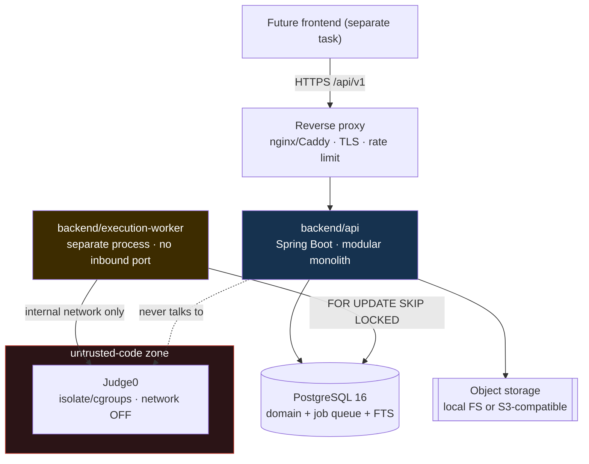
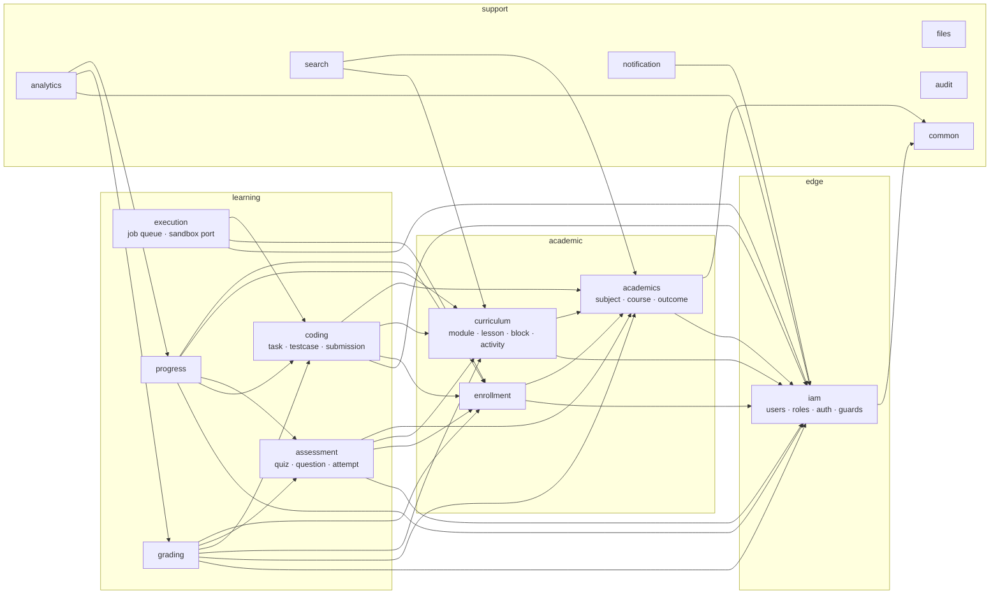
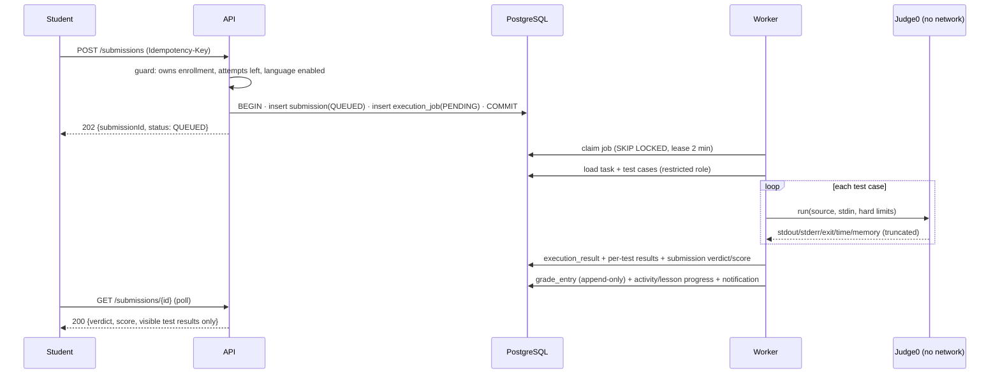

# Architecture

Decisions live in `../decisions/`. This is the map.

## Deployment topology



The dotted line is the point of the whole design: the API process has **no path** to the
sandbox, and the worker has a deliberately crippled database role.

## Module map (inside `backend/api`)



Arrows are the **only** allowed dependency directions. `ArchitectureBoundaryTest` enforces it,
plus: no cycles, no module reaching into another's `persistence`, layers inward-only.

`ac`/`cu`/`en`/`as`/`co` each point at `iam` for one specific reason: each implements one of
`iam.app.access`'s single-implementer ownership ports (`CourseTeacherLookup`, `CurriculumLocator`,
`EnrollmentLookup`, `AssessmentLocator`, `CodingLocator`) so `AccessGuard` can resolve "does this
caller own this object" without `iam` depending downward on them. `CurriculumLocator` originally
also carried `courseIdOfQuiz`/`courseIdOfCodingTask`, but a single `Optional<CurriculumLocator>`
bean can only have one implementer — ADR-013 split those out into `AssessmentLocator`/
`CodingLocator`, one port per owning module, once `assessment` (then `coding`) actually needed to
implement one.

`as --> ac` and `co --> ac`, for the same reason `cu --> ac` does: `quizzes.course_id` and
`coding_tasks.course_id` are both direct FKs to `courses`, exactly like `content_blocks`'s
(indirect, via module/lesson) and `activities`' (direct) course ownership —
`QuizService`/`CodingTaskService` resolve/validate the owning course through
`academics.app.CourseService`, the same way `ActivityService` already does. Not a new pattern,
just the same one extended to each module that needed it next.

`pr` points at `iam` for a second, distinct reason (ADR-012): it has a teacher-facing,
course-scoped endpoint (`GET /teacher/courses/{id}/progress`) and simply *calls*
`AccessGuard.requireCourseEditor` as a consumer — it implements no port. Its two student-facing
endpoints need no `iam` at all: ownership there is "the caller's own active enrollment", resolved
entirely through the already-allowed `en`/`cu` edges (ADR-004 Layers 3/4). `as`'s and `co`'s
`-> iam` edges happen to serve both reasons at once (each implements its own locator port *and*
consumes `AccessGuard` for its own teacher-authoring endpoints).

`gr --> iam` is this second reason too (Phase 9) — `AdminGradeController`/`AdminFeedbackController`
call `AccessGuard.requireCourseEditor` (grades: resolved from the enrollment's course) and
`requireCourseEditor` again per-target-type for feedback's polymorphic `target_type`; `grading`
implements no locator port of its own. `gr --> cu` and `gr --> ac` exist because
`FinalScoreCalculator` needs `academics.domain.AssessmentComponent`/`GradeScale` directly (a
grade entry's `assessment_component_id` and a course's grading scale are both owned by
`academics`), and the auto-grade wiring needs `curriculum.app.ActivityService` to resolve an
`Activity`'s own `assessment_component_id`/`maxPoints` before folding a graded quiz attempt or
coding submission into the gradebook — `gr --> as`/`gr --> co` (already allowed) supply the
`QuizAttemptGradedEvent` listener and the coding-submission poller respectively.

`an --> iam` is the same second reason again (Phase 11): `AdminAnalyticsController`'s course-scoped
endpoints call `AccessGuard.requireCourseEditor` directly, exactly like `pr`'s teacher roster
endpoint — `analytics` implements no locator port of its own either. Its quiz-/coding-task-scoped
endpoints resolve `courseId` from the already-queried view row itself (`v_quiz_performance`/
`v_coding_task_difficulty` both carry `course_id`) rather than depending on `assessment`/`coding`
just to look up a course id a read-only view already has.

`ex --> iam` is `pr`'s second reason, not the port-implementer one: `TeacherSubmissionController`
(a teacher-facing, coding-task-scoped roster/review endpoint) calls
`AccessGuard.requireCodingTaskEditor` as a plain consumer — `execution` implements no locator
port of its own (`CodingLocator` belongs to `coding`, which already owns `coding_tasks`). `ex -->
en` exists for the same reason `as`/`co --> en` do: `SubmissionMapper.toStudentSummary` reads
`submission.getEnrollment().getStudent()` to build the teacher roster row, the same shape as
`assessment.api.AttemptMapper#toStudentSummary`.

Two reasons justify `-> iam`: implementing one of its ownership ports, or consuming
`AccessGuard` from a teacher-facing endpoint. Don't add a general `iam` dependency for anything
else.

## Request flow (a student opens a lesson)

```
GET /api/v1/courses/{id}/lessons/{lessonId}?locale=uz
  JwtAuthenticationFilter        -> authenticate, load authorities from token
  RequestIdFilter                -> attach requestId to MDC + response header
  @PreAuthorize(LESSON_READ)     -> coarse permission
  LessonQueryService             -> @Transactional(readOnly)
    CourseAccessGuard.requireEnrolledIn(courseId)   -- ownership (ADR-004 L2)
    lessonRepository.findPublishedForStudent(lessonId, enrollmentId)  -- SQL scoping (L3)
      @EntityGraph(blocks, translations)            -- no N+1
    LocaleResolver + ContentBlockAssembler          -- resolve locale, assemble typed blocks
  -> LessonDetailResponse (record)  + Progress touch (async, separate tx)
```

## Layering inside a module

```
<module>/api/           controllers, DTO records, springdoc annotations   (no business logic)
<module>/app/           application services (@Transactional), validators, ports, mappers
<module>/domain/        entities, enums, value objects, invariants        (no Spring imports)
<module>/persistence/   Spring Data repositories, JPQL/native queries
```
Controllers never touch repositories. Domain never imports Spring. Cross-module calls go
through the other module's `app` service interface.

## Async code-execution flow



## Cross-cutting

| Concern | Where |
|---|---|
| Errors | `common.error.GlobalExceptionHandler` → `ApiError` |
| Pagination | `common.api.PageResponse`, `PageableSupport` (size cap 100) |
| Locale | `common.i18n.LocaleResolver` |
| Auditing | `@Auditable` + `AuditAspect` → `audit_log` |
| Request id | `RequestIdFilter` → MDC → JSON logs → `ApiError.requestId` |
| Idempotency | `common.idempotency.IdempotencyService` + `Idempotency-Key` |
| Optimistic locking | `@Version` on concurrently-edited entities |
| Content sanitization | `common.content.ContentSanitizer` (on write) |
| Caching | Caffeine: `subjects`, `courses`, `role-permissions` |
