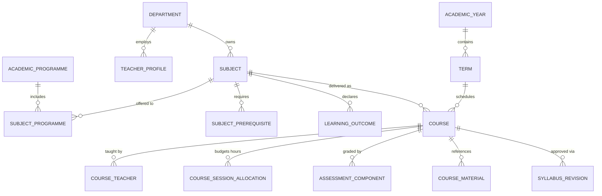
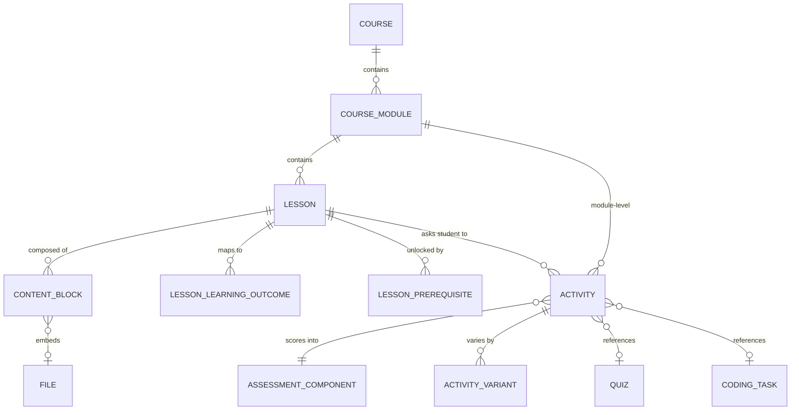
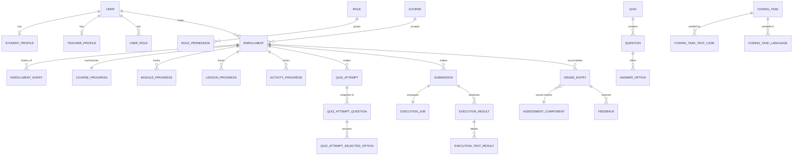

# Domain model

Derived from the two supplied syllabi (`../academic-analysis/syllabus-analysis.md`).
Locale-free structure + `*_translations` siblings (ADR-005); translation tables are omitted
from the diagrams for readability.

## 1. Institution & catalogue



**`Subject` vs `Course` is the load-bearing distinction.** `Subject` = the stable catalogue
entry (`DAS1110`), owned by a department, attached to programmes, carrying learning outcomes
and prerequisites. `Course` = **one delivery in one term** with its own credits, hour budget,
language, teachers and rubric. Proof it is necessary: `DAS1110` runs across two semesters with
6 and 5 credits and two different topic lists.

## 2. Content tree



`lessons.session_type` ∈ `LECTURE` | `SEMINAR` | `PRACTICAL` | `LABORATORY` |
`INDEPENDENT_STUDY` — straight from the institutional form. The same topic legitimately
appears in two tracks (e.g. `IAKTT1105` S7 and MT9 are both Big Data), so lessons are not
deduplicated by title.

`content_blocks.block_type` ∈ `TEXT` `IMAGE` `VIDEO` `CODE_EXAMPLE` `CALLOUT` `DIAGRAM`
`TABLE` `CASE_STUDY` `FILE` `LINK` `EMBED` `QUIZ_REF` `CODING_TASK_REF` `ACTIVITY_REF`.
Payload is validated per type (`ContentBlockPayloadValidator`).

`activities.activity_type` ∈ `QUIZ` `CODING_TASK` `MANUAL_TASK` `CASE_STUDY` `PRESENTATION`
`GROUP_PROJECT` `FILE_SUBMISSION`. **This is the multi-subject extension point.** Cybersecurity
case studies, Networks configuration exercises and AI practicals are new types + handlers, not
new schemas. No code anywhere branches on a subject code.

## 3. Enrolment, progress, assessment, grading



**`Enrollment` is the spine.** Every student-owned row (progress, attempt, submission, grade)
hangs off `enrollment_id`, never a bare `user_id`. That makes "another student's data" not
merely forbidden but *unrepresentable* — the cheapest possible enforcement of brief §9 and §60.

Progress is deliberately **four-level** (course / module / lesson / activity), not a single
percentage, so a teacher can answer "who is behind, and where" (brief §26).

## 4. Key lifecycles

```
Subject / Course / Module / Lesson / Quiz / CodingTask
  DRAFT ──publish──► PUBLISHED ──archive──► ARCHIVED
    ▲                    │
    └──── unpublish ─────┘        (publishing runs CoursePublicationValidator)

Enrollment
  PENDING ─► ACTIVE ─► COMPLETED | FAILED
              ├─► SUSPENDED ─► ACTIVE
              └─► WITHDRAWN            (terminal; history kept in enrollment_events)

QuizAttempt   IN_PROGRESS ─► SUBMITTED ─► GRADED
                          └─► EXPIRED | ABANDONED

Submission    QUEUED ─► RUNNING ─► COMPLETED(verdict) | FAILED
ExecutionJob  PENDING ─► CLAIMED ─► RUNNING ─► SUCCEEDED | FAILED ─► (retry) | DEAD

GradeEntry    DRAFT ─► PUBLISHED ─► REVISED (superseded) | VOIDED     [append-only]
```

## 5. Enumerations owned by the domain

`UserStatus` `RoleCode` `SubjectKind` `SubjectStatus` `DegreeLevel` `SessionType`
`DeliveryMode` `PublicationStatus` `LearningOutcomeCategory` `RequirementType`
`ContentBlockType` `ActivityType` `CollaborationMode` `VariantStrategy` `Difficulty`
`AssessmentComponentKind` `QuestionType` `AnswerMatchMode` `AttemptStatus`
`EnrollmentStatus` `ProgressStatus` `SubmissionStatus` `Verdict` `ExecutionJobStatus`
`ScoringStrategy` `TestCaseVisibility` `ComparisonMode` `GradeSource` `GradeStatus`
`MaterialType` `NotificationType` `AuditAction` `Locale`.

All stored as `text` + CHECK constraint (ADR-009): extending an enum is a one-line migration,
and a bad value is impossible.
